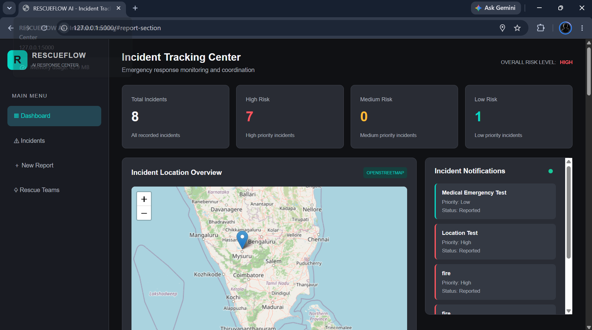
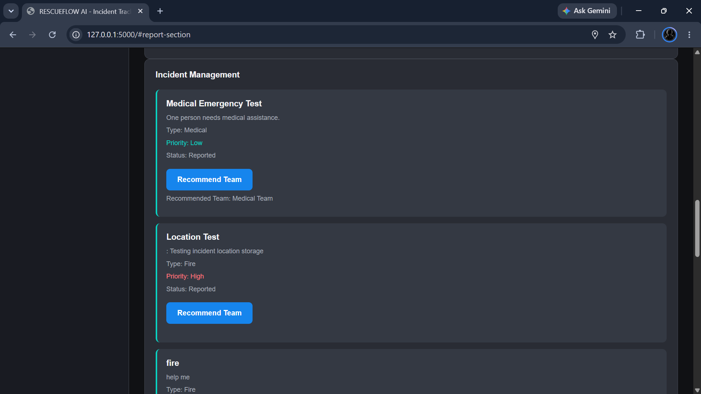
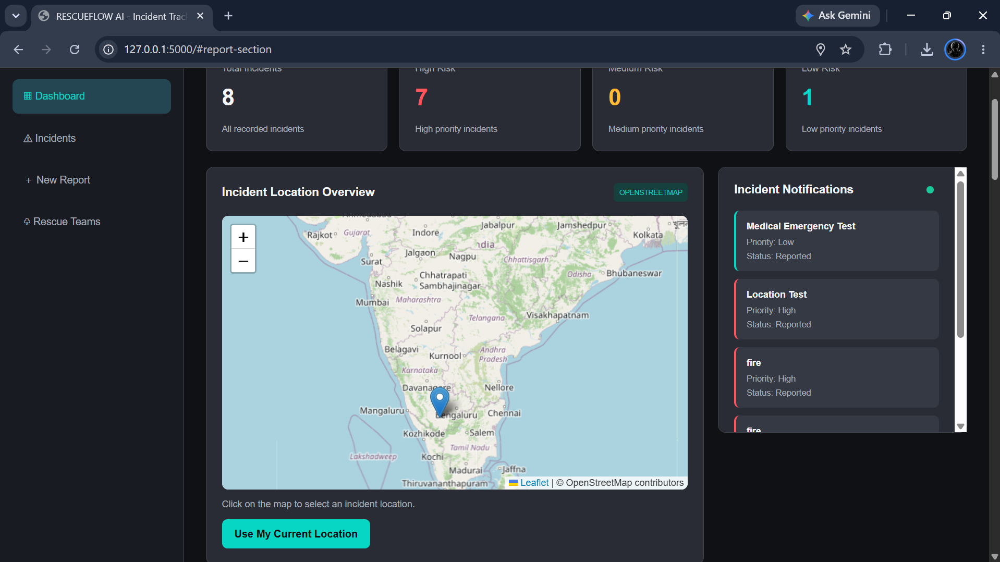
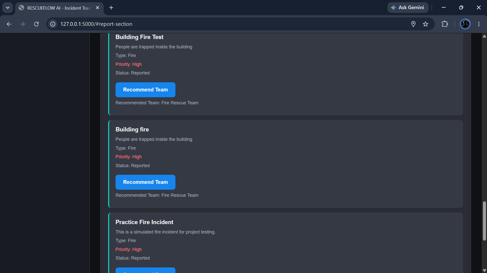
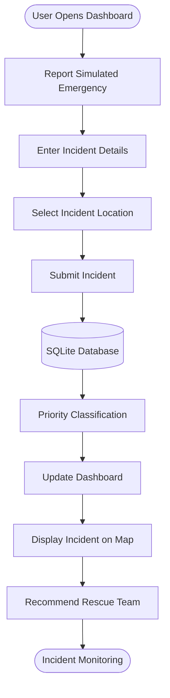
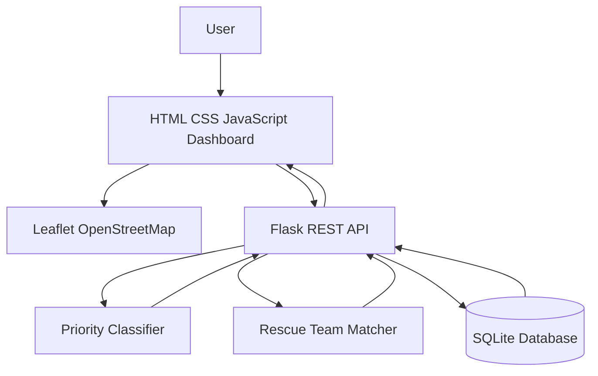

# 🚨 RESCUEFLOW AI
### Smart Emergency Response & Coordination Platform

<p align="center">
  
  
  
</p>

<p align="center">
  <b>REPORT FASTER • ANALYZE SMARTER • COORDINATE BETTER</b>
</p>

---

## 🌍 1. Project Overview

RESCUEFLOW AI is an AI-assisted emergency response coordination prototype designed to demonstrate how technology can help organize emergency incident reporting and rescue team coordination.

It provides a centralized dashboard to report simulated emergencies, classify incident priority, visualize incident locations, and recommend suitable rescue teams.

The main objective is to demonstrate a smarter and more organized emergency response workflow.

## 🖥️ 2. Application Preview

### Main Dashboard

<!-- Save your actual dashboard screenshot as docs/screenshots/dashboard.png -->



*Centralized monitoring dashboard displaying incidents, risk levels, notifications, and analytics.*

### Incident Management

<!-- Save your actual incident management screenshot as docs/screenshots/incidents.png -->



*View reported incidents, their descriptions, priorities, and current statuses.*

### Interactive Incident Map

<!-- Save your actual map screenshot as docs/screenshots/map.png -->



*Visualize saved incident locations using Leaflet and OpenStreetMap.*

### Rescue Team Recommendation

<!-- Save your actual rescue team screenshot as docs/screenshots/rescue-team.png -->



*Get a recommended rescue team based on the reported incident type.*

---

## ✨ 3. Key Features

| Feature | What it does |
|---|---|
| 📊 Dashboard | Displays incident statistics |
| 🚨 Incident Reporting | Records simulated emergencies |
| 🧠 Priority Classification | Uses keyword-based rules to classify incidents |
| 🗺️ Interactive Map | Displays incident locations |
| 📍 Location Selection | Supports map selection and browser GPS |
| 👨‍🚒 Team Recommendation | Matches incident types with rescue teams |
| 🔔 Notifications | Displays recent incident reports |
| 📈 Analytics | Shows incident category and risk information |
| 🗄️ Database | Stores incident records in SQLite |

---

## 🔄 4. How RESCUEFLOW AI Works

The following diagram explains the complete incident workflow.



### Step-by-Step Working

**Step 1 – Report an Emergency**

The user enters the incident title, type, and description.

**Step 2 – Select Location**

The user selects a location on the interactive map or uses browser location permission.

**Step 3 – Save Incident**

The application stores incident information and coordinates in SQLite.

**Step 4 – Classify Priority**

The Python priority classifier checks keywords and assigns High, Medium, or Low priority.

**Step 5 – Update Dashboard**

The dashboard displays incident statistics, notifications, categories, and risk levels.

**Step 6 – Recommend Rescue Team**

The team-matching service recommends a suitable team based on incident type.

---

## 🏗️ 5. System Architecture



### Architecture Components

- **Frontend:** Displays the dashboard and accepts incident reports.
- **Flask Backend:** Handles application routes and API requests.
- **Priority Classifier:** Assigns priority using predefined keywords.
- **Team Matcher:** Finds a matching rescue team.
- **SQLite:** Stores incident information.
- **Leaflet:** Displays interactive map locations.

---

## 🧠 6. Priority Classification

RESCUEFLOW AI uses a rule-based keyword classifier.

| Priority | Example keywords |
|---|---|
| 🔴 High | Fire, trapped, unconscious, explosion, collapsed |
| 🟠 Medium | Smoke, accident, flood, injured, blocked road |
| 🟢 Low | Other reports without matching higher-priority keywords |

### Classification Example

**Input:**

```text
Title: Building Fire
Description: People are trapped inside the building.
Type: Fire
```

**Output:**

```text
Priority: HIGH
```

*Note: This is a rule-based prototype, not a trained machine-learning model.*

---

## 👨‍🚒 7. Rescue Team Coordination

The system recommends teams according to incident type.

| Incident Type | Recommended Team |
|---|---|
| Fire | Fire Rescue Team |
| Medical | Medical Team |
| Flood | Flood Rescue Team |

Example:

```text
Incident: Medical Emergency Test
Type: Medical

Recommended Team:
Medical Team
```

---

## 🛠️ 8. Technology Stack

<p align="center">
  
</p>

| Technology | Purpose |
|---|---|
| Python | Backend programming |
| Flask | Web framework |
| HTML5 | Page structure |
| CSS3 | Dashboard styling |
| JavaScript | Interactive functionality |
| SQLite | Database |
| Flask-SQLAlchemy | Database integration |
| Leaflet.js | Interactive mapping |
| OpenStreetMap | Map tiles |
| Git & GitHub | Version control |

---

## 📁 9. Project Structure

```text
RESCUEFLOW_AI/
│
├── app/
│   ├── models/
│   │   └── incident.py
│   │
│   ├── routes/
│   │   └── incidents.py
│   │
│   ├── services/
│   │   ├── priority_classifier.py
│   │   └── team_matcher.py
│   │
│   ├── extensions.py
│   └── __init__.py
│
├── static/
│   ├── css/
│   │   └── style.css
│   └── js/
│       └── script.js
│
├── templates/
│   └── dashboard/
│       └── index.html
│
├── docs/
│   └── screenshots/
│       ├── dashboard.png
│       ├── incidents.png
│       ├── map.png
│       └── rescue-team.png
│
├── tests/
├── data/
├── app.py
├── requirements.txt
├── README.md
└── .gitignore
```

---

## 🚀 10. Installation & Setup

### Prerequisites

- Python 3.10 or newer
- Git
- VS Code or another code editor

### Step 1 – Clone Repository

```bash
git clone YOUR_GITHUB_REPOSITORY_URL
```

### Step 2 – Open Project

```bash
cd RESCUEFLOW_AI
```

### Step 3 – Create Virtual Environment

```bash
python -m venv .venv
```

### Step 4 – Activate Environment

Windows PowerShell:

```powershell
.\.venv\Scripts\Activate.ps1
```

### Step 5 – Install Dependencies

```bash
pip install -r requirements.txt
```

### Step 6 – Start Application

```bash
python app.py
```

### Step 7 – Open Dashboard

Visit:

```text
http://127.0.0.1:5000/
```

---

## 🎯 11. Project Objectives

- Demonstrate centralized emergency incident management.
- Provide automatic rule-based priority classification.
- Visualize incident locations.
- Demonstrate rescue team matching.
- Explore how web technologies can support emergency coordination.

---

## 🔮 12. Future Enhancements

- 🤖 Machine-learning-based incident classification.
- 📱 Mobile application.
- 🔔 SMS and email notifications.
- 👥 User authentication and role-based access.
- 🚑 Live rescue team tracking.
- ☁️ Cloud database integration.
- 📍 Advanced geospatial analysis.

---

## ⚠️ 13. Safety Disclaimer

RESCUEFLOW AI is an educational and hackathon prototype.

It is not connected to official emergency services. Its priority classification and team recommendations are demonstrations only and must not be relied upon for real emergency dispatch, medical decisions, or rescue operations.

---

## ⭐ 14. Support & Contribution

If you find this project interesting:

- ⭐ Star the repository.
- 🍴 Fork the project.
- 🐛 Report issues.
- 💡 Suggest improvements.

---

<p align="center">
  <b>RESCUEFLOW AI</b><br/>
  Smart Technology for Better Emergency Coordination.
  <br/><br/>
  Built with ❤️ using Python, Flask and JavaScript.
</p>